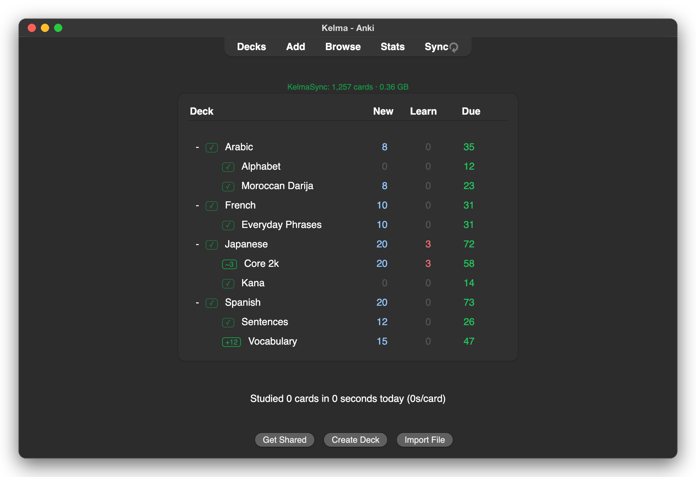
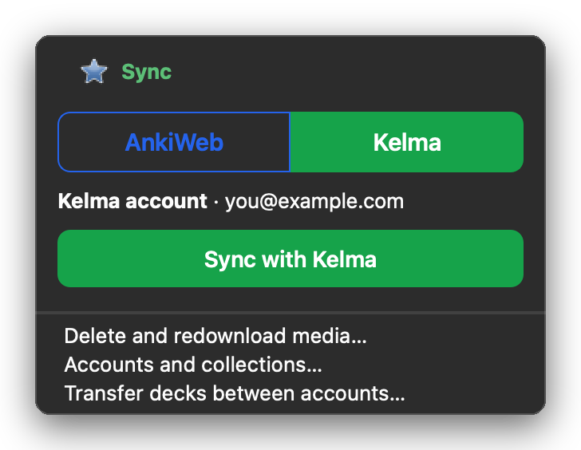
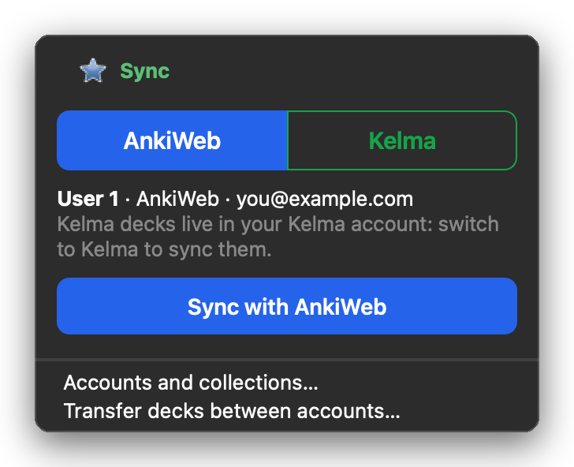
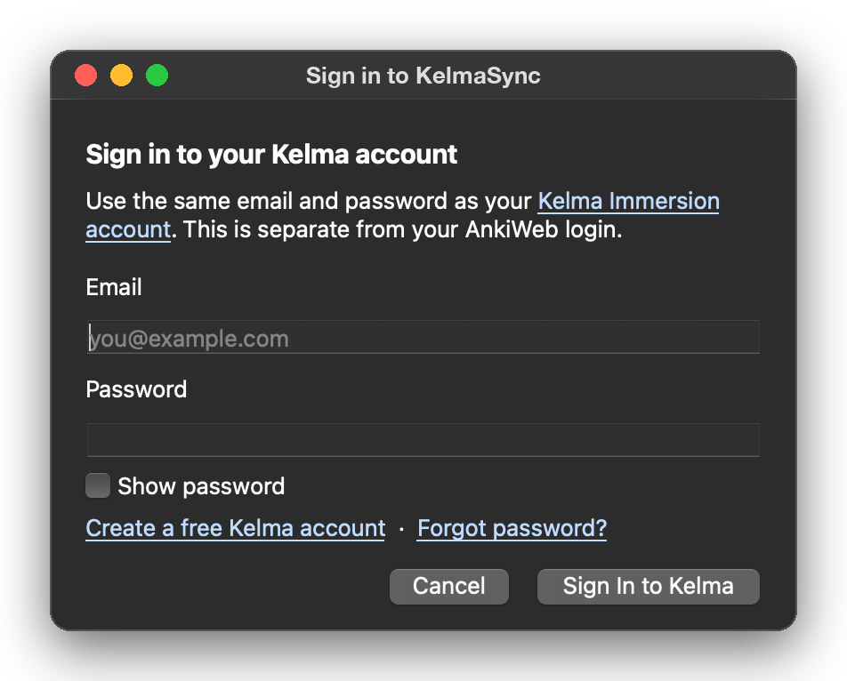
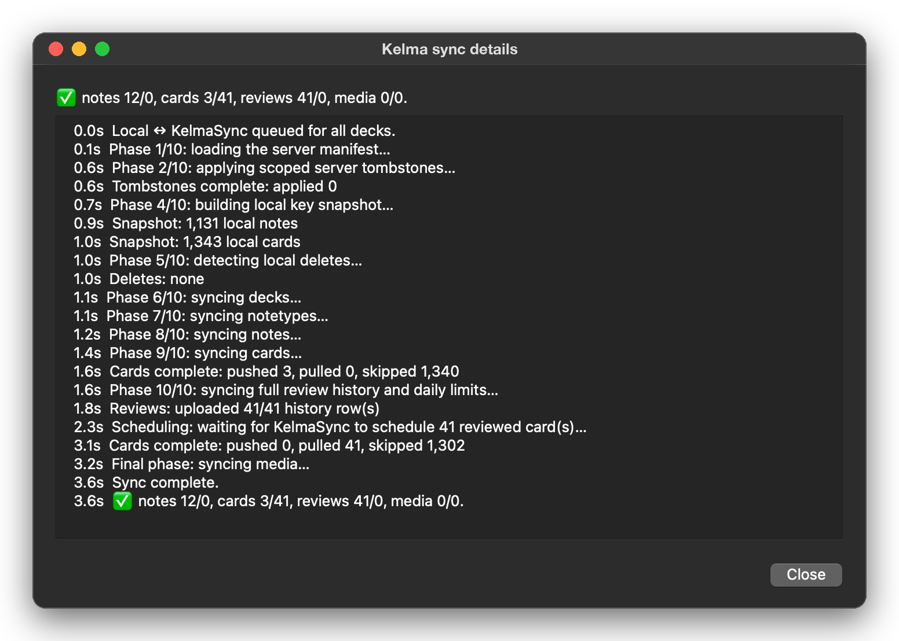
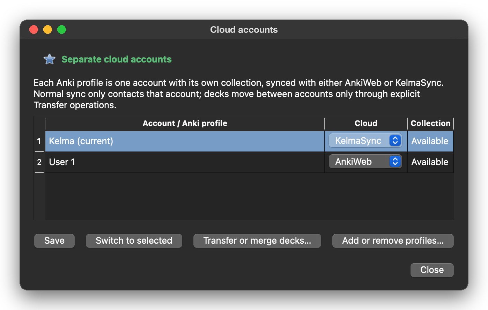
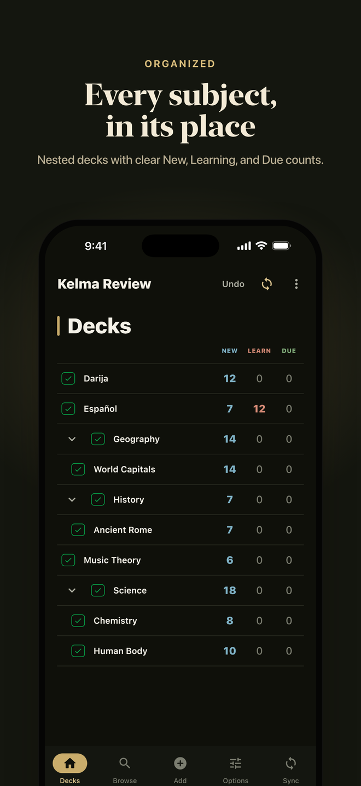
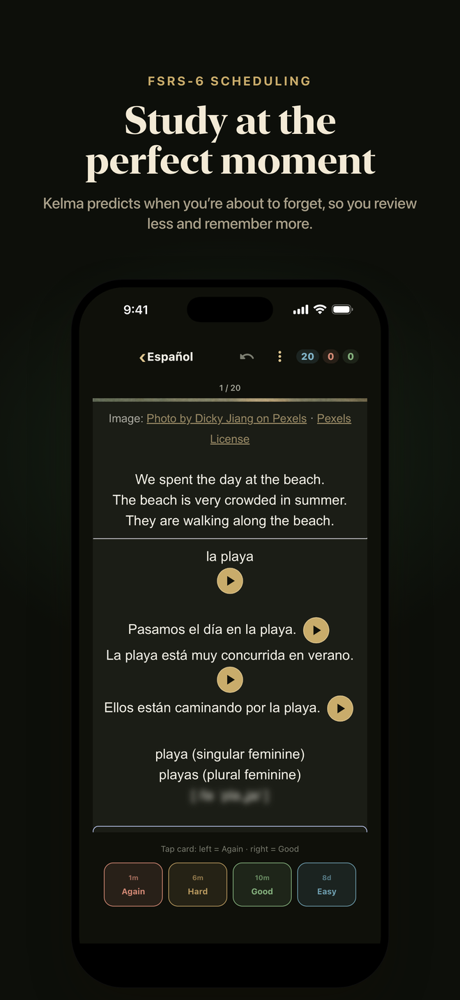

<p align="center">
  <a href="https://kelma.tech"></a>
</p>

<h1 align="center">Kelma for Anki</h1>

<p align="center">
  Sync Anki with your Kelma account and keep studying the same decks in
  <a href="https://github.com/jdmc43/kelma-review">Kelma Review</a> on your phone:
  the same cards, due dates and daily counts everywhere.<br>
  Your AnkiWeb profiles keep syncing with AnkiWeb exactly as before.
</p>

<p align="center">
  <a href="https://kelma.tech/files/kelma-anki-addon.ankiaddon"></a>
  &nbsp;
  <a href="https://kelma.tech/signup"></a>
</p>

<p align="center">
  <b>Study on your phone with Kelma Review</b><br><br>
  <a href="https://apps.apple.com/app/kelma-review/id6800817799"></a>
  &nbsp;
  <a href="https://play.google.com/store/apps/details?id=tech.kelma.app"></a>
</p>

<p align="center">
  <a href="https://kelma.tech">kelma.tech</a>
  &nbsp;·&nbsp;
  <a href="https://kelma.tech/downloads">All Kelma downloads</a>
  &nbsp;·&nbsp;
  <a href="https://github.com/jdmc43/kelma-review">Kelma Review on GitHub</a>
  &nbsp;·&nbsp;
  <a href="https://github.com/jdmc43/kelma-sync">KelmaSync server</a>
</p>

<p align="center">
  <a href="https://kelma.tech/updates/v1.json"></a>
  
  <a href="LICENSE"></a>
</p>

<p align="center">
  
</p>

## Install

1. Download [`kelma-anki-addon.ankiaddon`](https://kelma.tech/files/kelma-anki-addon.ankiaddon)
   from [kelma.tech](https://kelma.tech/downloads).
2. In Anki, choose **Tools → Add-ons → Install from file…** and pick the
   download (or double-click the file), then restart Anki.
3. Click **Sync**, choose **Kelma**, and sign in with your Kelma account. No
   account yet? [Create one for free](https://kelma.tech/signup).
4. Get [Kelma Review](https://github.com/jdmc43/kelma-review) for
   [iPhone and iPad](https://apps.apple.com/app/kelma-review/id6800817799) or
   [Android](https://play.google.com/store/apps/details?id=tech.kelma.app) and
   sign in with the same account to study the same decks on the go.

The add-on checks kelma.tech for updates and asks before installing one
(**Tools → Kelma → Check for Kelma updates…** checks now).

## What it looks like

<table>
  <tr>
    <td width="50%" valign="top">
      
    </td>
    <td width="50%" valign="top">
      
    </td>
  </tr>
  <tr>
    <td colspan="2">
      <b>One Sync button, two clouds.</b> The <b>AnkiWeb | Kelma</b> toggle switches
      between your Kelma profile and your AnkiWeb profile. Each profile syncs
      only with its own cloud, so nothing is ever copied between them by accident.
    </td>
  </tr>
  <tr>
    <td width="50%" valign="top">
      
    </td>
    <td width="50%" valign="middle">
      <b>Sign in once</b> with the same email and password you use for Kelma
      Review and kelma.tech. Your password is never stored; the add-on keeps
      only a sign-in token inside the Kelma profile.
      <br><br>
      No account yet? <a href="https://kelma.tech/signup">Create one for free at kelma.tech</a>.
    </td>
  </tr>
  <tr>
    <td colspan="2" align="center">
      
      <br>
      <b>Syncs in the background.</b> Anki's sync icon spins and a short note
      reports what changed. Click <b>Sync</b> while it runs to see the full log.
    </td>
  </tr>
  <tr>
    <td colspan="2" align="center">
      
      <br>
      <b>Accounts and collections.</b> Every Anki profile belongs to exactly one
      cloud. Reassign profiles or move decks between them explicitly.
    </td>
  </tr>
</table>

## Kelma Review

<p align="center">
  <a href="https://github.com/jdmc43/kelma-review"></a>
</p>

<p align="center">
  <a href="https://github.com/jdmc43/kelma-review">Kelma Review</a> is the free,
  open source flashcard app for iPhone, Android, macOS, Windows and Linux that
  shares your Kelma decks with Anki. Review on your phone, keep editing in
  Anki: both show the same due dates and daily counts.
</p>

<p align="center">
  
  
  
</p>

<p align="center">
  <a href="https://apps.apple.com/app/kelma-review/id6800817799"></a>
  &nbsp;
  <a href="https://play.google.com/store/apps/details?id=tech.kelma.app"></a>
  <br>
  <sub>
    Desktop downloads and source code:
    <a href="https://github.com/jdmc43/kelma-review">github.com/jdmc43/kelma-review</a>
    · <a href="https://kelma.tech/downloads">kelma.tech/downloads</a>
  </sub>
</p>

## How accounts work

1. Install the add-on and restart Anki. It adds a **Kelma** profile for your
   Kelma account (once; an existing profile assigned to KelmaSync is reused).
2. Click **Sync**. The popup has an **AnkiWeb | Kelma** toggle: choose
   **Kelma** to switch to the Kelma profile. If you are not signed in, the
   add-on asks you to sign in with your Kelma account (or create one at
   kelma.tech), then syncs your Kelma decks. Kelma decks show a green ✓, or
   `+added` / `~changed` until the next sync.
3. Choose **AnkiWeb** in the same toggle to return to your last AnkiWeb profile.
   **Tools → Kelma → Switch to … account** does the same.

Open **Tools → Kelma → Accounts and collections…** to assign profiles, switch
accounts, or open Anki's profile manager to add/remove profiles.

## Account model

An Anki profile is the local boundary for an account:

```text
Anki profile / account A                 Anki profile / account B
┌────────────────────────┐               ┌────────────────────────┐
│ collection.anki2       │               │ collection.anki2       │
│ collection.media/      │               │ collection.media/      │
│ provider: AnkiWeb      │               │ provider: KelmaSync    │
└───────────┬────────────┘               └───────────┬────────────┘
            │ native sync                            │ KelmaSync v2
            ▼                                        ▼
         AnkiWeb                                  KelmaSync
```

- Collections, media, sync cursors, and credentials stay profile-scoped.
- AnkiWeb authentication remains owned by the Anki profile.
- Kelma bearer tokens are stored in a mode-`0600` file inside that profile.
- The shared account registry stores only profile names and provider types; it
  never stores passwords, tokens, or collection content.
- Profiles are AnkiWeb accounts unless assigned to KelmaSync, so existing
  profiles keep syncing with AnkiWeb exactly as before.
- A Kelma account blocks native AnkiWeb auto-sync. An AnkiWeb account never runs
  KelmaSync during normal sync.

## Explicit deck transfer

Accounts remain separate by default. Choose **Tools → Kelma → Transfer decks
between accounts…**, select one deck in each account, then choose:

- **Insert** — copy a deck that does not exist in the destination. Its name,
  notes, cards, review history, scheduling, deck configuration, and media are
  retained. The source remains unchanged.
- **Overwrite** — replace the selected destination deck with the preferred
  account's version. Destination cards are removed first; a backup is created.
- **Merge** — designate the two selected deck namespaces as the same deck.
  One-sided notes/cards are unioned into both accounts. Differing notes enter a
  conflict table where the version retained in both accounts is selected;
  newest versions are suggested, while ties require an explicit choice.
  Scheduling converges by GUID/template identity and newest card modification.

Merge creates backups of both collections. Operations include subdecks and
media but never contact either cloud automatically. Sync each affected account
explicitly afterward when ready. Automatic deletion propagation remains off.

## Provider behavior

### AnkiWeb account

The Sync button runs Anki's native collection/media sync. KelmaSync credentials
or collections are never consulted.

### KelmaSync account

The Sync button runs KelmaSync v2 against the entire profile collection. It does
not run AnkiWeb before or afterward. KelmaSync's independent card study state
maps to Anki suspension (`queue = -1`); buried queues remain local. Schedule
reset maps to Anki's native Schedule as New operation while preserving revlog
history. Manual due-date overrides map to native Set Due Date; manual revlog and
post-sync baselines distinguish explicit changes from normal scheduling, and a
later rated review or reset clears the override.

Notes, cards, immutable review history, notetypes, decks, media, tombstones,
study state, reset cutoffs, and manual due dates use the existing KelmaSync v2
newest-wins pipeline. Passwords are never stored.

**Same due dates as Kelma Review.** KelmaSync schedules every card with FSRS-6
from its review history. The add-on places those schedules on the account's
study days (time zone and day-start hour from the study-day policy), exactly as
Kelma Review does: a review card is due at the start of the study day "study day
of the last review + interval", and learning steps that cross into a later study
day become due that day. Anki's "next day starts at" follows the account, and
Anki's deck presets get the account's FSRS parameters, desired retention,
learning steps and maximum interval, so reviews done in Anki schedule the same
way. After uploading reviews, a sync waits for the server to schedule them and
pulls the result in the same pass. Cards placed by older versions on UTC days
are moved once (and again if the study-day policy changes).

**Same daily counts as Kelma Review.** Kelma Review allots new cards first
(they count against the review limit), applies every parent deck's limits and
buries siblings, and it counts what was studied today from the review history,
so reviews done in Kelma Review or on another device count as soon as they are
synced. The add-on turns on Anki's "new cards ignore review limit",
"apply all parent limits" and sibling burying, and sets each deck's "today
only" limits to what Kelma Review allots, so the deck list and the study screen
show the same new/learn/due numbers. Those "today only" values stay local and
are recomputed after every sync, when a profile opens and when the day changes.

**Syncing in the background.** Sync runs with Anki's spinning sync icon and a
short note at the end; clicking Sync while it runs (or "Last sync details…"
afterwards) shows the full log. Only problems that need a decision open a
window.

**Fast repeat syncs.** The last full server manifest is kept next to the
collection (`kelma_server_manifest.json.gz`); later syncs ask only for what
changed since then (a full refresh happens at least daily). HTTP connections are
reused; deck/notetype records that another client serialised differently are
compared in normalised form once and remembered; review rows already verified
are not hashed again; the study-day policy and FSRS profile are re-read every
ten minutes; and nothing is re-read when a sync changed nothing.

Large media restores use the same prepared-TAR protocol as Kelma Kotlin: 128 MiB
/ 10,000-file batches, up to five concurrent preparations in first-ready order,
and exactly one streaming TAR GET at a time. Interrupted one-shot jobs are
replaced with only unfinished entries. Ordinary updates use exactly 64 bounded
authenticated proxy workers. Files are size-checked, staged, and atomically
published without buffering an archive or collection in memory. **Delete and
redownload media…** removes files already backed by the current KelmaSync
account, retains local-only files, and immediately runs the complete resumable pull.

## Migration from older dual-sync versions

Older releases (1.0.131 and earlier) used one master collection, kept a hidden
copy of it per service, and reconciled it with both AnkiWeb and KelmaSync. That
machinery is gone: there are no hidden copies, no AnkiWeb comparison, and no
per-deck routing. This release does not attempt to split an already mixed
collection automatically, because doing so would require guessing ownership.

On first launch:

1. Existing Kelma credentials are moved from global add-on config into the
   currently open profile.
2. The add-on adds a **Kelma** profile; switch to it from the Sync button and
   sign in to pull your Kelma decks into it.
3. Profiles not assigned to KelmaSync are AnkiWeb accounts and resume Anki's
   native sync. Reassign them in **Accounts and collections…** if needed.
4. Use explicit Merge only for content you intentionally want to copy.

The hidden copies the old releases kept next to each collection are no longer
used. When a profile still has them, the add-on offers once to delete them;
answering No keeps them and it does not ask again. They can also be deleted by
hand from the profile folder: `kelma_shadow_kelmasync.anki2` and
`kelma_shadow_ankiweb.anki2`, each with its `.media` folder and `.media.db2`
file. The profile's own collection and media are never touched.

## Install (development)

```bash
cd kelma-anki-plugin
./build.sh dev
# Fully quit Anki (⌘Q on macOS), then relaunch.
```

Package for distribution:

```bash
./build.sh
# creates dist/kelma.ankiaddon
```

The server-backed end-to-end test lives here—not in the server repository—and
uses the sibling `../kelma_sync_2` checkout by default:

```bash
ANKI_PY="$HOME/Library/Application Support/AnkiProgramFiles/.venv/bin/python"
PYTHONPATH=src "$ANKI_PY" tests/e2e_sync_server.py
```

Set `KELMA_SYNC_SERVER_REPO` to test against a server checkout elsewhere.

## Requirements

- Modern Anki with the Rust backend (approximately 23.10 or newer).
- One Anki profile per cloud account.
- KelmaSync v2 access for Kelma accounts.

## Source and license

This repository is distributed under the GNU Affero General Public License
v3.0; see [`LICENSE`](LICENSE).
